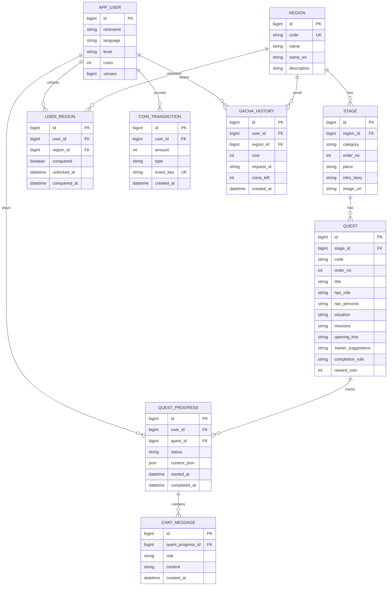

# DB 구조

Spring Data JPA / Hibernate가 MySQL 8.4의 테이블을 생성·관리한다. H2는 사용하지 않는다.
개발용 `ddl-auto: update`로 테이블을 만들고 `data.sql`에서 초기 콘텐츠를 넣는다.
배포 환경에서 버전별 스키마 변경이 필요해지면 마이그레이션 도구를 도입한다.

## 무결성과 동시 요청

- `user_region`: `(user_id, region_id)` 유일.
- `quest`: `(stage_id, order_no)`, `(stage_id, code)` 각각 유일.
- `quest_progress`: `(user_id, quest_id)` 유일. 실제 상태는 `IN_PROGRESS / COMPLETED`.
- `coin_transaction.event_key`: 유일. `INITIAL:{user}`, `QUEST_CLEAR:{user}:{quest}`, `REGION_CONQUER:{user}:{region}`, `GACHA:{user}:{requestId}`.
- `gacha_history`: `(user_id, request_id)` 유일. 재시도하면 기존 지역과 당시 코인 잔액을 반환한다. 지역 상세의 진행 정보는 조회 시점 기준이다.
- 코인·진행을 바꾸는 서비스는 먼저 사용자를 `PESSIMISTIC_WRITE`로 잠근다. `app_user.version`은 낙관적 잠금도 제공한다.
- 퀘스트 완료·보상 내역·잔액·정복 상태는 한 트랜잭션, 뽑기 차감·해금·내역도 한 트랜잭션이다.
- 최초 지급 코인도 내역에 저장한다. `amount`는 지급 양수, 사용 음수다.
- 채팅은 `(quest_progress_id, id)` 인덱스로 조회한다.

## 콘텐츠와 사용자 상태

- `Region → Stage(장소) → Quest(순차 과제)`. 동일 지역·분야에 장소 여러 개를 등록할 수 있다.
- `region/stage/quest`만 `data.sql`로 등록한다. ID가 이미 있으면 건너뛰므로 재시작해도 사용자 기록과 콘텐츠를 덮어쓰지 않는다.
- 현재 초기 데이터: 서울 25개 구, 기존 장소 10개, 퀘스트 13개. 장소 5는 문화 분야의 전통시장이며 퀘스트 501~504가 Q01~Q04다. 나머지 장소는 기존 대화 미션을 단일 퀘스트로 보존했다.
- 명세에 없는 나머지 신규 장소는 임의로 만들지 않았다. 장소·퀘스트 수와 진행률은 등록 데이터로 계산한다.
- 잠김/시작 가능 여부와 장소 클리어 여부는 지역 해금 및 앞 퀘스트 완료 기록으로 계산한다.
- `quest_progress.context_json`에 주문 품목·수량·간 제외·포장·흥정 가격 등의 상태를 저장한다. 완료한 상태와 대화는 재입장해도 유지한다. 미완료 과제 재시작은 해당 과제의 임시 상태와 대화만 초기화한다.
- `ALL_MISSIONS`는 기존 콘텐츠용 규칙이다. 미션 표시·추천 표현은 콘텐츠의 `|` 구분 문자열, 완료 번호는 context의 JSON 배열로 관리한다.
- LLM은 미션 번호/상태 변경을 제안한다. 서버가 허용된 필드·자료형·순서·필수 주문 조건을 확인하고 완료/코인 지급을 결정한다.
- 시장의 9,000원 예산은 퀘스트 상황 값이며 가챠 코인과 무관하다.

## 실행과 데이터 보존

`.env.example`을 `.env`로 복사하고 비밀번호를 설정한 후 `docker compose up -d --wait`로 MySQL을 시작한다.
MySQL 데이터는 `mysql_data` 볼륨에 보관된다. `docker compose down`이나 앱 재시작 후에도 유지된다.
기존 H2 메모리 데이터는 이전 대상이 아니며 새 MySQL DB에서 시작한다.
`/api/demo/reset`은 사용자 기록만 삭제하고 초기 콘텐츠는 남긴다.
