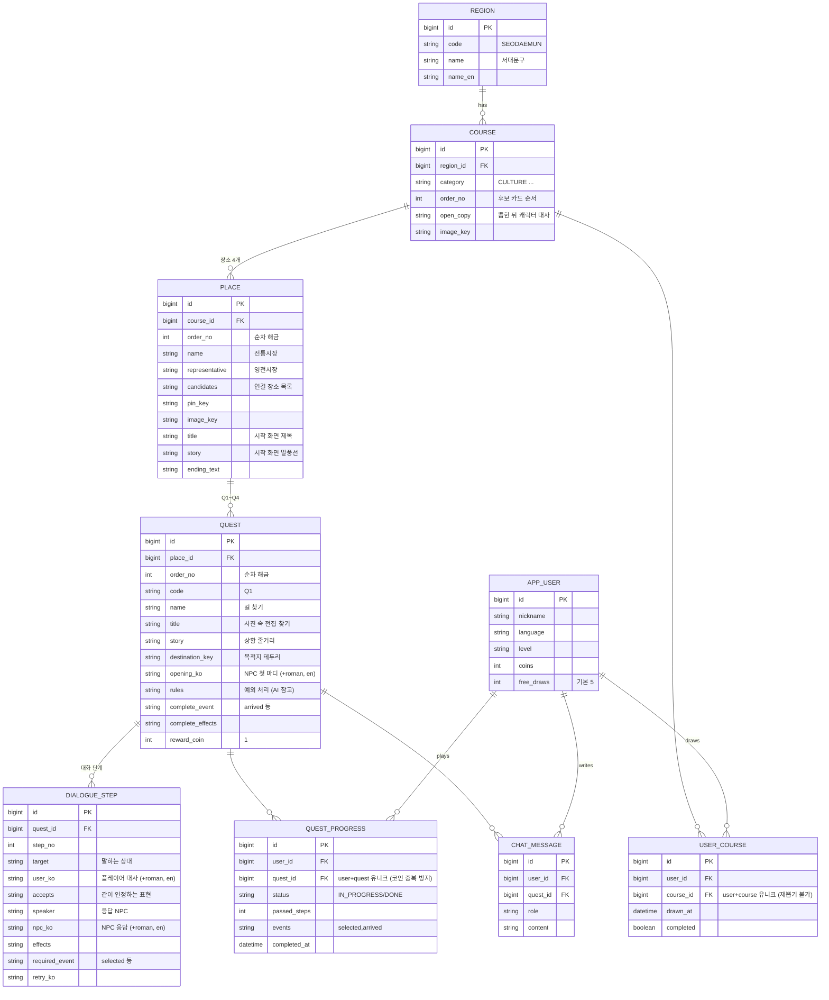

# DB 구조

| 테이블 | 역할 | 데이터 |
|---|---|---|
| region | 서울 25개 구 | `data.sql` |
| course | 가챠 후보 5개 (지역·카테고리) | `data.sql` |
| place | 코스당 장소 4개 | `data.sql` |
| quest | 장소당 Q1~Q4 | `data.sql` |
| dialogue_step | 퀘스트의 대화 단계 (한국어·로마자·영어) | `data.sql` |
| app_user | 코인, 남은 무료 뽑기 | API |
| user_course | 뽑은 코스, 완료 여부 | 뽑기 |
| quest_progress | 통과한 단계 수, 받은 이벤트, 완료 | 퀘스트 진행 |
| chat_message | 대화 기록 (AI 맥락, 표현 카드) | 퀘스트 진행 |

**퀘스트 추가하는 법:** `data.sql`의 `quest`에 한 줄, `dialogue_step`에 단계 수만큼 줄을 추가하면 끝. 코드 수정 없음.
