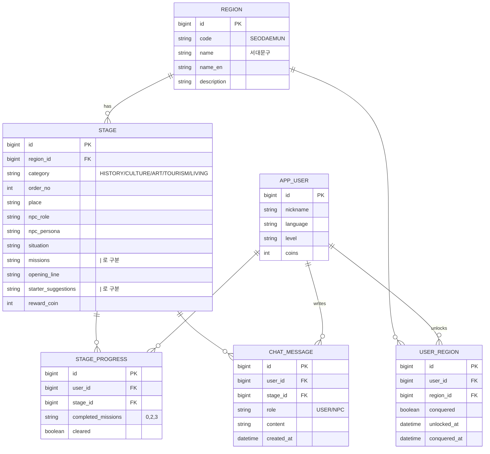

# DB 구조

| 테이블 | 역할 | 데이터 출처 |
|---|---|---|
| region | 서울 25개 구 | `data.sql` (고정) |
| stage | 구별 5개 분야 스테이지 | `data.sql` (고정, 행 추가로 확장) |
| app_user | 플레이어, 코인 | API로 생성 |
| user_region | 가챠로 해금한 구, 정복 여부 | 가챠 시 생성 |
| stage_progress | 스테이지별 완료 미션, 클리어 여부 | 대화 시 생성 |
| chat_message | 대화 기록 (AI 맥락 + 표현 카드) | 대화 시 생성 |
